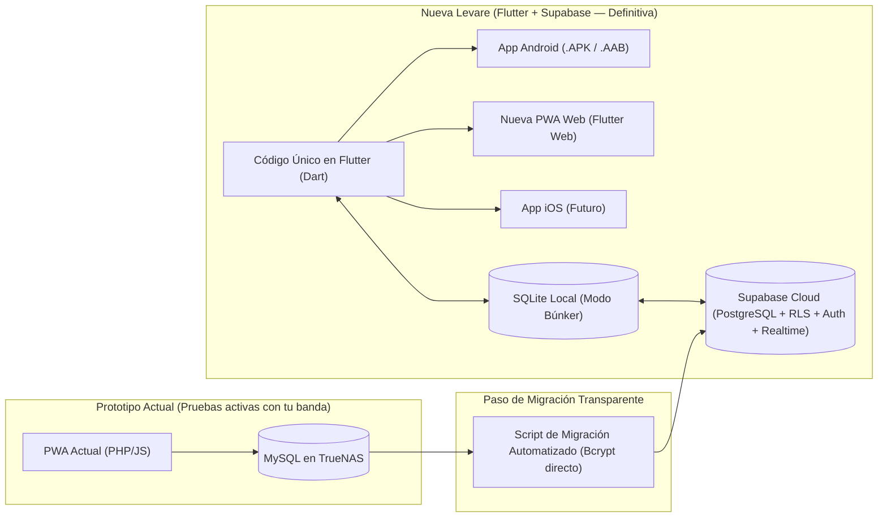

# Hoja de Ruta Maestra — Levare (Rumbo a `v1.0.0` en Flutter + Supabase)

Esta hoja de ruta establece el plan maestro para construir la versión definitiva de **Levare** en **Flutter + Supabase**, manteniendo el prototipo actual (PHP + MySQL en TrueNAS) como entorno activo de pruebas para tu banda hasta que la nueva aplicación esté lista y se realice la migración transparente de datos antes de apagar TrueNAS definitivamente.

---

## 1. Estrategia de Versionado Oficial (SemVer Rumbo a `v1.0.0`)

Dado que el proyecto actual en PHP/JS es un prototipo interno en pruebas de campo con tu equipo, la nueva aplicación en **Flutter + Supabase** nacerá con el siguiente ciclo de vida hacia su **versión `1.0.0` oficial**:

| Versión | Etapa | Propósito y Alcance |
| :--- | :--- | :--- |
| **`v0.1.0-alpha`** | Cimientos, Auth y Catálogo | Base en Flutter, Tema Dual, Modo Búnker (SQLite local), Login (Correo/Google), Multi-tenancy de bandas, Biblioteca de canciones y Catálogo Comunitario. |
| **`v0.2.0-alpha`** | Eventos, Setlists y Organización | Armado de repertorios, Calendario de eventos, Confirmación de asistencia, Programa del culto, Vestimenta, Termómetro de ensayo y matriz de "Rol del Mes". |
| **`v0.3.0-alpha`** | Escenario y Modo Concierto | Visor de atril avanzado (Nashville, Hoja Compacta, 2 Columnas, Capo, Notas en 3 capas), Live Sync en tiempo real (Internet + Red Local QR) y Señas del Director. |
| **`v0.4.0-alpha`** | Herramientas del Músico y Cierre | Pads ambientales continuos, Acordes puente de transición, Metrónomo, Afinador cromático, Exportador PDF, Rango vocal y Panel de Superadmin. |
| **`v0.9.0-beta`** *(o `v1.0.0-beta.1`)* | **Migración de Datos y Entrega de APK** | **Ejecución del script de migración transparente de datos (usuarios, contraseñas, canciones y banda)**. Entrega del **`.apk` de Android** y la **PWA Web** a tus 22 músicos/coristas. **Se apaga TrueNAS definitivamente.** |
| **`v1.0.0`** | **Lanzamiento Oficial Estable** | Versión pública consolidada tras superar el periodo de pruebas de campo con tu banda y corregir los detalles reportados en la fase Beta. |

---

## 2. Arquitectura de Transición (Sin tocar la PWA actual)

> [!TIP]
> **¿Por qué este enfoque es el ideal para tu banda?**
> 1. **Continuidad operativa:** Tu equipo puede usar la PWA actual en sus próximos eventos sin detenerse.
> 2. **Cero fricción en el traspaso:** Las contraseñas encriptadas con **bcrypt** en PHP son 100% compatibles con **Supabase Auth**. Tus 22 músicos y coristas no tendrán que registrarse de nuevo ni cambiar de clave; descargarán el APK y entrarán con su mismo correo y contraseña.
> 3. **Preservación total del repertorio:** Todas las canciones, letras y tonos que carguen los líderes durante este tiempo se transferirán íntegras a Supabase.
> 4. **Limpieza de historial:** Los eventos ya concluidos se descartan para arrancar con una base de datos ligera y limpia en Supabase.

---

## 3. Las 3 Macro-Etapas de la Hoja de Ruta

El proyecto se organiza en **3 pasos principales**, cada uno detallado en su propio documento de planificación:

### Paso 1: Especificación Funcional Definitiva de Levare (`v1.0`)
* **Documento:** `docs/planes/paso_1_especificacion_funcional.md`.
* **Objetivo:** Definir y aprobar la lista exacta de las **19 funcionalidades** que tendrá la aplicación (fusionando lo mejor de tu prototipo actual con las mejores funciones de Setlio) antes de crear la base de datos.

### Paso 2: Construcción de la Base de Datos Definitiva en Supabase (PostgreSQL)
* **Documento:** `docs/planes/paso_2_base_de_datos_supabase.md`.
* **Objetivo:** Crear de una sola vez el esquema completo en **Supabase (PostgreSQL)** con sus 18 tablas, políticas **RLS**, **Login con Google + Email**, almacenamiento y el script preparado para la importación directa de cuentas y canciones desde TrueNAS.

### Paso 3: Desarrollo de Levare en Flutter (Pantalla por Pantalla: `v0.1.0` ➔ `v1.0.0-beta`)
* **Documento:** `docs/planes/paso_3_desarrollo_flutter.md`.
* **Objetivo:** Construir la aplicación en Flutter dividida en **10 fases secuenciales**, ejecutar la migración transparente de los datos de tu banda en la Fase 3.10, distribuir el `.apk` a tu equipo y **apagar definitivamente TrueNAS**.
