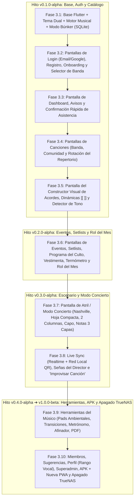

# Plan de Implementación — Paso 3: Desarrollo de Levare en Flutter (Pantalla por Pantalla: `v0.1.0` ➔ `v1.0.0-beta`)

Con las funcionalidades definidas (Paso 1) y la base de datos lista en **Supabase** con su estructura definitiva (Paso 2), este tercer plan detalla el desarrollo controlado de la aplicación en **Flutter** a través de **10 fases secuenciales**, avanzando desde `v0.1.0-alpha` hasta alcanzar `v0.9.0-beta` / `v1.0.0-beta` y apagar definitivamente los servicios en TrueNAS.

---

## Mapa de Fases y Versiones de Desarrollo

---

## Hito `v0.1.0-alpha`: Cimientos, Autenticación y Catálogo de Canciones

### Fase 3.1: Cimientos del Proyecto, Motor Musical en Dart y "Modo Búnker"
1. **Inicialización y Sistema de Diseño (`core/theme/`):**
   * Crear el proyecto en Flutter y configurar el Tema Dual (`zinc-950` / `zinc-900` en Modo Oscuro; `zinc-100` / `white` en Modo Claro), colores de acento y fuentes `Playfair Display` + `Inter`.
   * Construir el layout base adaptativo (Barra de navegación inferior en móvil y menú lateral en tablet/web) y el sistema de modales minimalistas.
2. **Motor Musical en Dart (`core/music_engine/`):**
   * Programar en Dart los motores de parseo y transposición con soporte para:
     * Cifrado Inglés (`C, Fm7, G/B`), Latino (`Do, Fam7`) y **Grados Nashville (`1, 4m7, 5/7`)**.
     * Etiquetas de dinámica en línea (`[[Suave]]`, `[[Crece]]`) y acordes agrupados (`[(C - G - Am - F)]`).
     * **Detector Automático de Tono** (calcula la tonalidad probable según los acordes escritos).
     * **Sugeridor de Capo** (calcula el traste óptimo para formas abiertas en guitarra).
3. **Motor Offline y Modo Búnker (`core/database/`):**
   * Configurar SQLite local (`drift`) que sincroniza en segundo plano canciones, repertorios y eventos desde Supabase.
   * Añadir en la barra superior el interruptor **"Modo Búnker"** para lectura 100% local en el escenario.

---

### Fase 3.2: Pantallas de Autenticación, Onboarding y Selector de Banda
1. **Pantalla de Login y Registro:**
   * Inicio de sesión con Correo/Contraseña y botón **"Continuar con Google"** mediante `supabase_flutter`.
   * Flujo de cambio obligatorio de contraseña temporal en el primer ingreso.
2. **Pantalla de Onboarding y Unión a Banda:**
   * Elección inicial: *Crear nueva banda* o *Unirse con código de invitación*.
3. **Selector de Banda Activa (Multi-Tenant):**
   * Selector rápido en la cabecera para alternar entre las bandas del usuario y sincronizar su caché local.

---

### Fase 3.3: Pantalla de Dashboard (Inicio Inteligente)
1. **Tarjeta Principal del Próximo Evento:**
   * Muestra fecha, hora, tipo de evento, rol asignado al músico, código de vestimenta y botón directo para abrir el repertorio.
   * **Confirmación Rápida de Asistencia (`Asistiré` / `No puedo`):** Botones interactivos para confirmar asistencia desde el inicio, más indicador de cuántos integrantes han confirmado.
2. **Muro de Avisos de la Banda y Tarjetas de Resumen.**

---

### Fase 3.4: Pantallas de Biblioteca de Canciones, Comunidad y Rotación
1. **Pestaña "Repertorio de la Banda":**
   * Lista de canciones de la banda con buscador instantáneo, filtros por tono/BPM y etiquetas de metadatos.
2. **Pestaña "Rotación del Repertorio":**
   * Clasificación automática conectada a la vista analítica de Supabase: **Tocadas hace poco**, **Olvidadas (Para rescatar)** y **Sin estrenar**.
3. **Pestaña "Catálogo Comunitario Levare":**
   * Explorador paginado de las canciones públicas de la comunidad, sistema de *Likes*, vista previa con cambio de tono e importación directa al catálogo de la banda.

---

### Fase 3.5: Pantalla del Constructor Visual y Editor de Cifra
1. **Paso 1 — Datos y Metadatos Musicales:**
   * Título, Artista, Álbum, Tono Original, **Tono Final (si modula)**, **BPM (con botón Tap Tempo)**, **Compás** (`4/4`, `3/4`, `6/8`) y enlaces de YouTube / Spotify.
2. **Paso 2 — Constructor por Tarjetas + Editor de Texto:**
   * Edición visual por bloques (`INTRO`, `VERSO`, `CORO`, `PUENTE`) con selector de **Dinámica de Sección** (*Suave, Crece, Fuerte, Solo voces, Corte*) y posicionamiento táctil de acordes.
   * Modo de edición rápida por texto con barra de atajos para corchetes `[ ]` y dinámicas `[[ ]]`.
   * **Importador por URL / Texto** y **Alerta de Verificación Automática de Tono** antes de guardar.

---

## Hito `v0.2.0-alpha`: Eventos, Setlists y Programación Mensual

### Fase 3.6: Pantallas de Eventos, Setlists, Programa del Culto y "Rol del Mes"
1. **Pantalla de Armado de Repertorios (Setlists):**
   * Selección y ordenamiento de canciones, asignación de tono específico para el evento, elección de quién canta cada tema y sugerencia automática de **Acordes Puente de Transición** entre canciones.
2. **Pantalla de Detalle de Evento (con 4 Pestañas):**
   * **Repertorio + Termómetro de Ensayo:** Cada músico marca cada canción como *Por aprender / En ensayo / Lista* y se muestra la barra de preparación del equipo.
   * **Programa del Evento (Orden del Culto):** Escaleta cronológica con bloques musicales y no musicales (*Bienvenida, Lectura Bíblica, Avisos, Ofrenda, Prédica*), duración y encargado.
   * **Alineación (Roster) y Confirmaciones:** Lista de músicos por instrumento, estado de confirmación (`Confirmado`, `Pendiente`, `No puede`) y botón **"Recordar a pendientes"**.
   * **Código de Vestimenta:** Estilo y paleta visual de colores para ese evento.
3. **Pantalla de Matriz "Rol del Mes":**
   * Cuadrícula mensual (Filas = Instrumentos, Columnas = Fechas del mes) con contador en vivo de cuántas veces toca cada integrante en el mes y creación masiva de los eventos del mes.

---

## Hito `v0.3.0-alpha`: Escenario en Vivo y Modo Concierto

### Fase 3.7: Pantalla de Visor de Canción y "Modo Concierto" (Atril)
1. **Controles de Escenario:**
   * Transposición instantánea (`-` / `+` semitonos), configuración de **Capo Personalizado** con sugerencia inteligente y selector de notación (**C-D-E** / **Do-Re-Mi** / **Nashville 1-4-5**).
2. **4 Modos de Visualización del Atril:**
   * **Estándar** (Letra + Acordes + Dinámicas), **Hoja Compacta** (1 sola vista solo con bloques y acordes sin letra), **Vista a 2 Columnas** (sin scroll en horizontal/tablets) y **Modo Cantante** (Solo Letra).
3. **Notas en 3 Capas por Sección:**
   * Panel por sección para ver y agregar **Nota de la Banda**, **Nota del Evento** y **Nota Mía (Privada)**.
4. **Autoscroll, Pantalla Siempre Activa (`WakeLock`) y soporte de Pedal Bluetooth / Swipe.**

---

### Fase 3.8: Live Sync (Tiempo Real), Señas del Director e "Improvisar Canción"
1. **Sincronización Dual (Nube + Red Local sin Internet):**
   * **Modo Nube:** Sincronización vía **Supabase Realtime Broadcast**.
   * **Modo Red Local (Wi-Fi / Hotspot con QR):** El teléfono del Director abre un servidor local y muestra un código QR para que los músicos se conecten directamente en el mismo Wi-Fi aunque no haya internet.
2. **Sincronización de Canción, Tono y Salto de Sección:**
   * El Director controla qué canción y tono ven todos, y al tocar una sección (`[CORO]`, `[PUENTE]`) hace saltar el atril de los músicos a esa parte.
3. **Panel de Señas Rápidas del Director (*Live Cues*) e "Improvisar Canción":**
   * Botones en vivo (*Repetir sección, Suave, Subir intensidad, Solo voces, Corte en el 1, Mantener acorde* + señas propias de la banda) que muestran un aviso destacado arriba del atril de todos los músicos, además del buscador rápido para **improvisar una canción** fuera del setlist.

---

## Hito `v0.4.0-alpha` ➔ `v1.0.0-beta`: Herramientas, Cierre y Apagado de TrueNAS

### Fase 3.9: Herramientas del Músico y Exportador PDF
1. **Reproductor de Pads Ambientales Continuos:**
   * Audio continuo en los 12 tonos (*Cálido, Brillante, Sub*) con transición suave (*crossfade*) integrado en el Modo Concierto.
2. **Metrónomo Visual/Sonoro (auto-configurado con el BPM de la canción) y Afinador Cromático.**
3. **Exportador a PDF:**
   * Generación de hojas PDF de canciones o repertorios completos en formato **Estándar**, **Compacto**, **2 Columnas** o **Solo Letra** para imprimir o compartir por WhatsApp.

---

### Fase 3.10: Miembros, Sugerencias, Perfil (`¿Quién puede cantarla?`), APK y Transición Final
1. **Directorio de Miembros, Roles y Módulo de Sugerencias/Votación.**
2. **Perfil del Músico y Rango Vocal (`¿Quién puede cantarla?`):**
   * Configuración de tema, foto de perfil y **Rango Vocal** para sugerir en cada canción qué cantantes de la banda se adaptan mejor al tono.
3. **Panel de Superadministrador y Buzón de Feedback.**
4. **Ejecución de la Migración Transparente y Compilación de `v1.0.0-beta`:**
   * **Paso A (Migración de Datos):** Ejecutar el script de migración para transferir a Supabase los 22 usuarios (con sus contraseñas encriptadas con bcrypt intactas), la banda y el catálogo de canciones acumulado durante las pruebas, descartando eventos antiguos.
   * **Paso B (Compilación y Despliegue):** Generar el instalador **`.apk`** de Android y compilar la **nueva PWA Web** desde Flutter desplegándola en la nube.
   * **Paso C (Entrega al Equipo):** Compartir el enlace del APK a los 22 integrantes para que inicien sesión con su mismo correo y contraseña de siempre sin fricción.
   * **Paso D (Apagado):** Desconectar y **apagar definitivamente los servicios en TrueNAS**.
